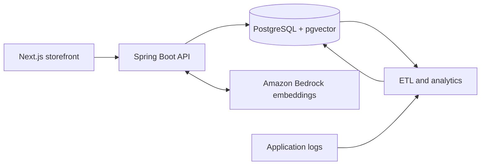

## About the Project

Net Computer is a data-driven commerce platform focused on intelligent product recommendations. It uses embeddings and behavioral data analysis.

The platform is built with Next.js, Spring Boot, and PostgreSQL with pgvector.


## Architecture

The project follows an MVC-style, layered architecture organized as a modular monolith by business feature. The Next.js frontend provides the views, while the Spring Boot backend exposes REST controllers, services, domain models, and repositories.



## Starting Development

From the repository root, create a local `.env` file using `.env.example` as a template.

### Database
```powershell
docker compose -f docker-compose.local.yml up -d
```

Available at `localhost:5432`

### Frontend

```powershell
cd front-main
npm install
npm run dev
```

Available at `http://localhost:3000`

### Backend

```powershell
cd back-main
.\gradlew.bat bootRun
```

Available at `http://localhost:4001/api`
